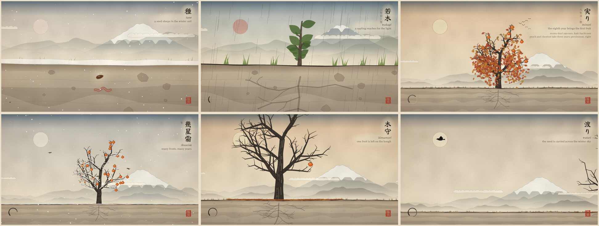

# Tree Lifecycle Zen

The life of a persimmon tree, painted in the manner of Japanese ink-wash (sumi-e) and woodblock prints (ukiyo-e).

A seed sleeps in the winter soil. It sprouts, grows through the turning seasons, bears its first fruit in its eighth year, grows old, and gives one last fruit back to the earth. Then the cycle begins again, and it loops forever.

## Watch it

Open `index.html` in a modern browser. It is one self-contained file with no build step and no libraries. The brush-calligraphy fonts come from Google Fonts. Offline, the inscriptions fall back to your system's Japanese serif.

To put it online, enable GitHub Pages for this repository (Settings → Pages → deploy from a branch, root folder). The page is then served at `https://<your-user>.github.io/tree_lifecycle_zen/`.

## The cycle

1. **種 tane.** A seed sleeps in the winter soil, seen in cross-section, while an earthworm turns the earth beside it.
2. **芽生え mebae.** A root reaches down. The shoot hooks up through the soil and opens its two seed leaves.
3. **若木 wakagi.** A sapling. The view draws back as it grows, revealing the mountains and Mount Fuji.
4. **四季 shiki.** The years pass as a time-lapse of seasons: fresh spring green, summer rain drawn in long straight lines like Hiroshige's, red autumn leaves, and snow on bare branches.
5. **実り minori.** The first fruit comes in the eighth year, as the proverb says: 桃栗三年柿八年, "peach and chestnut take three years; persimmon, eight". Each year the persimmons hang on the bare branches into the first snow until small birds strip them.
6. **幾星霜 ikuseisō.** Many frosts, many years. The trunk thickens, moss gathers, and a few limbs die back.
7. **木守 kimamori.** In the tree's last autumn the birds leave a single fruit on the bough. In Japan the last persimmon is traditionally left on the tree for the birds and for next year's harvest.
8. One of the two endings below.
9. **輪廻 rinne.** The seed is back in the soil, and the wheel turns again.

## The two endings

The two endings take turns, starting with the falling fruit.

- **The fruit falls** (落果 rakka, 朽ちる kuchiru, 土に還る tsuchi ni kaeru). The last persimmon drops, bruises, rots and collapses as the first snow comes, and its seed slips into the soil beside the parent tree. Through the next cycle the old tree dies standing (無常 mujō, impermanence). Its twigs wither, its limbs crack and fall, the trunk snaps, and the stump softens into moss and mushrooms. Meanwhile the new sapling grows up in its place.
- **The crow** (鴉 karasu, 渡り watari, 種を落とす tane o otosu). A crow lands beside the last persimmon and eats it. It carries the seed across the winter sky, past the sun, and drops it on new ground far away, where the next tree begins.

Every cycle grows a different tree, so no two loops are quite the same.

## Controls

The controls appear along the bottom when you move the pointer or tap, and they stay visible while the animation is paused.

| Control | Key | What it does |
| --- | --- | --- |
| Pause / Play | `Space` | Stops and resumes time |
| Tempo | `←` `→` | ½×, 1×, 2× or 4× speed |
| Ending | `E` | Both in turn, only the falling fruit, or only the crow. The change applies to the next ending that hasn't started yet. |
| Inscriptions | `C` | Shows or hides the calligraphy captions |

URL parameters are useful for sharing a particular moment or tree:

| Parameter | Example | Effect |
| --- | --- | --- |
| `t` | `?t=84` | Start at a moment, in seconds. A cycle lasts about 100 seconds at 1×. |
| `seed` | `?seed=7` | Grow a particular set of trees. A random set is grown on each visit otherwise. |
| `ending` | `?ending=bird` | `alt` (default), `fall` or `bird` |
| `speed` | `?speed=2` | `0.5`, `1`, `2` or `4` |
| `paused` | `?paused=1` | Start paused |
| `text` | `?text=0` | Start with the inscriptions hidden |
| `debug` | `?debug=1` | Show the clock, the tree's age and the camera |

If your system asks for reduced motion, the animation starts paused, the wind sway is damped and fewer particles fall.

## How it is made

- **One file, Canvas 2D.** Everything is drawn procedurally each frame. Each frame is a pure function of the clock, so pausing, changing tempo or jumping with `?t=` never drifts out of step.
- **Trees.** Each persimmon is generated from a seed. Branches are chains of segments, and each limb is born at its own age and swells with the tree, so the crown keeps its shape as it grows. Limb thickness follows the pipe model, where cross-section grows with the foliage carried above. Leaves bud, turn and fall in cohorts, and roots spread underground as a mirror of the crown.
- **Time.** A cycle covers about twelve years of the tree's life. Autumns linger and winters pass quickly. The first-fruit year and the last year are slowed down.
- **Painting.** The paper is washi with fibres and foxing, laid over the whole scene as a multiplied layer. At the top is the graded indigo band of a woodblock print (ichimonji bokashi). Below it, ink-wash mountains dissolve into mist, and long cloud bands (suyari-gasumi) cross the sky as in Japanese screens and scrolls. The bark has dry-brush streaks and moss dots. A vermilion seal reads 輪廻, and an ensō, the Zen brush circle, is drawn in the corner as the cycle runs.
- **Automation.** `window.__tlz.render(seconds)` renders any moment on demand and `window.__tlz.info()` describes the current cycle. Both are handy for screenshots.
